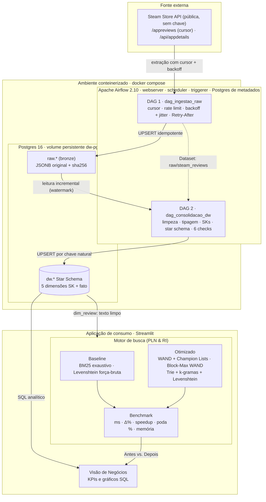
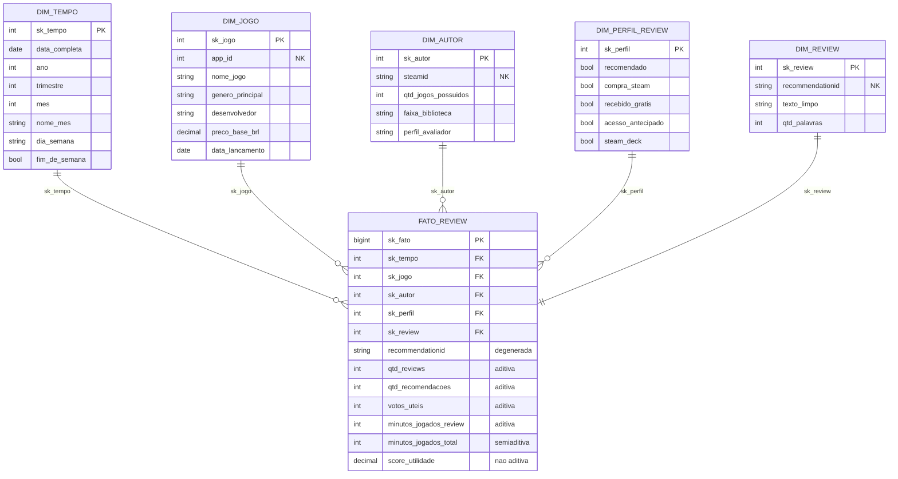

# 🎮 Steam Reviews Intelligence

**Pipeline analítico de ponta a ponta sobre o que os jogadores brasileiros escrevem na Steam:** ingestão resiliente com Apache Airflow, Data Warehouse dimensional (Kimball) e um motor de busca BM25 com poda **WAND + Champion Lists**, **Block-Max WAND** e **correção ortográfica em 2 estágios**, cada um com benchmark *Antes vs. Depois* cronometrado em milissegundos.


| | |
|---|---|
| **Aluno** | João Gilberto Leão Vieira (trabalho individual) |
| **Disciplinas** | Modelagem Informacional · Processamento de Linguagem Natural e Sistemas de Recuperação de Informação |
| **Curso** | Ciência de Dados para Negócios, FUCAPE Business School, 2026/2º bimestre |
| **Docente** | Prof. Dr. Wagner Perin |
| **Tema** | Entretenimento & Games: avaliações (reviews) em português de 16 jogos populares da Steam |

> **Destaques**
> * Até **40 mil reviews reais** em PT-BR na primeira carga (16 jogos × até 2.500 reviews cada), coletadas via API pública com paginação por cursor, *rate limit* e *exponential backoff* com jitter.
> * Modelo estrela com **5 dimensões** (incluindo uma *junk dimension* e membros desconhecidos `-1`), surrogate keys inteiras, FKs reais e **6 checks de qualidade** que barram a carga.
> * **3 técnicas de RI** implementadas do zero em Python puro, todas com **prova automática de segurança**: o Top-K otimizado é comparado com o exaustivo em 480 consultas aleatórias × 4 algoritmos nos testes.
> * Idempotência **comprovada por código**: teste de integração contra Postgres real no CI e script de impressão digital (MD5) do DW antes e depois do reprocessamento.
> * **62 testes automatizados**, lint PEP 8 (ruff) e GitHub Actions que valida o `docker-compose.yml` e importa as DAGs na imagem oficial do Airflow.

---

## Sumário
1. [Contexto de negócio e declaração da dor](#1-contexto-de-negócio-e-declaração-da-dor)
2. [Arquitetura de engenharia de dados](#2-arquitetura-de-engenharia-de-dados)
3. [Modelagem dimensional](#3-modelagem-dimensional)
4. [Inteligência de recuperação de informação](#4-inteligência-de-recuperação-de-informação)
5. [Resultados experimentais e benchmark](#5-resultados-experimentais-e-benchmark)
6. [Guia passo a passo de execução](#6-guia-passo-a-passo-de-execução-how-to-run)
7. [Estrutura do repositório e qualidade de software](#7-estrutura-do-repositório-e-qualidade-de-software)

---

## 1. Contexto de negócio e declaração da dor

O Brasil é um dos maiores mercados de games do mundo, e a **review da Steam é o principal termômetro público de um jogo**: o percentual de avaliações positivas aparece na página de compra e influencia diretamente a conversão. Para um estúdio, uma publicadora ou um time de *community management*, essas reviews são o maior acervo gratuito de feedback qualitativo do mercado.

**A dor:** esse feedback existe em volume (milhares de textos por jogo), mas está **preso numa API paginada, sem histórico e sem busca**. Hoje um analista não consegue responder com rapidez:

* "A taxa de recomendação do nosso jogo está caindo mês a mês? E a dos concorrentes?"
* "Jogadores com mais horas de jogo são mais críticos ou mais fãs?"
* "Onde estão as reclamações de **travamento**, **servidor** ou **otimização**?", sem ler milhares de reviews e mesmo quando o jogador escreve "trvando" ou "servdor".

**Objetivos estratégicos do produto:**

| Objetivo | Como o projeto entrega |
|---|---|
| Histórico confiável e incremental | DAG 1 coleta diariamente e preserva o payload bruto (bronze); o DW guarda tudo com idempotência |
| Métricas de satisfação comparáveis | Star Schema com taxa de recomendação, horas jogadas e votos úteis por jogo, tempo, perfil de jogador e origem da cópia |
| Descoberta de problemas em texto livre | Busca BM25 com Top-K em sub-milissegundos, tolerante a erros de digitação |
| Operação de nível produção | Airflow conteinerizado, retentativas, checks de qualidade, auditoria de ingestão e CI |

---

## 2. Arquitetura de engenharia de dados



### 2.1 Resiliência da ingestão (DAG 1)

| Mecanismo | Implementação |
|---|---|
| **Paginação por cursor** | `cursor=*` → `cursor` devolvido pela API, com `filter=recent` (mais novas primeiro). Para em página vazia, **cursor repetido**, página incompleta, watermark alcançado ou limite de páginas. |
| **HTTP 429 (rate limit)** | Retentativa com **exponential backoff + equal jitter**: `teto = min(60s, 1s·2ⁿ)`, `espera = teto/2 + U(0, teto/2)`. Se vier `Retry-After`, a espera nunca é menor que ele. |
| **Instabilidade** | 500/502/503/504, timeout, queda de conexão e "200 com HTML" são retentados (até 6×). |
| **Erros permanentes** | 400/403/404 falham na hora (não adianta insistir). |
| **Polidez** | ≥ 1 s entre requisições, no máximo 2 jogos em paralelo, User-Agent identificado. |
| **Retry do Airflow** | `retries=3`, `retry_exponential_backoff=True` (1 → 15 min). |
| **Falha parcial** | Mapeamento dinâmico (1 tarefa por jogo). A tarefa final (`ALL_DONE`) publica o Dataset se ao menos um jogo deu certo. |
| **Auditoria** | `raw.ingestion_log`: páginas, requisições, retentativas, 429 recebidos e motivo da parada, por jogo e execução. |

### 2.2 Idempotência em ambos os DAGs

| Camada | Garantia |
|---|---|
| Raw | `PK (recommendationid)` + `ON CONFLICT DO UPDATE ... WHERE payload_hash IS DISTINCT FROM` → *Clear/Retry* com o mesmo lote grava **0 linhas**. |
| Staging | `TRUNCATE` + reload a cada execução. |
| Dimensões | `UNIQUE` na chave natural + upsert: a SK de uma entidade nunca muda. |
| Fato | `UNIQUE (recommendationid)` + upsert: grão 1 review = 1 linha, então reprocessar **não infla métricas**. |
| Watermark | Avança só depois dos checks de qualidade (`GREATEST`), e uma falha no meio reprocessa a mesma janela. |

**Prova:** `python -m scripts.verificar_idempotencia` compara a impressão digital do DW (contagens, somas e **MD5 de todas as linhas da fato**) antes e depois de reprocessar a raw inteira. O teste `tests/test_integracao_dw.py` repete a prova no CI contra um Postgres real. Detalhes em [`docs/arquitetura.md`](docs/arquitetura.md).

### 2.3 Encadeamento

O DAG 2 é agendado por **Dataset** (`schedule=[RAW_REVIEWS_DATASET]`): ele roda **assim que o DAG 1 publica dados novos**, sem janela de tempo chutada.

---

## 3. Modelagem dimensional

> **Granularidade da fato `dw.fato_review`:** *cada linha representa UMA review publicada por um jogador sobre um jogo na Steam, na data em que a review foi criada.*



### Dicionário resumido

| Métrica | Tipo | Uso |
|---|---|---|
| `qtd_reviews`, `qtd_recomendacoes`, `qtd_nao_recomendacoes` | **Aditivas** | Volume e taxa de recomendação (`Σrec / Σreviews`) em qualquer corte |
| `votos_uteis`, `votos_engracados`, `qtd_comentarios`, `qtd_palavras` | **Aditivas** | Engajamento da comunidade |
| `minutos_jogados_review` | **Aditiva** | Experiência do autor ao escrever |
| `minutos_jogados_total` | **Semiaditiva** | Foto na data da coleta: não somar entre coletas |
| `score_utilidade` | **Não aditiva** | Média, nunca soma |

| Dimensão | Papel |
|---|---|
| `dim_tempo` | Calendário completo (dia, mês, trimestre, semestre, dia da semana, fim de semana) |
| `dim_jogo` | Jogo (SCD1): gênero, desenvolvedora, publicadora, preço em BRL, lançamento |
| `dim_autor` | Jogador (SCD1): tamanho da biblioteca e experiência como avaliador, em faixas |
| `dim_perfil_review` | ***Junk dimension***: 5 flags → 32 combinações pré-populadas |
| `dim_review` | Texto limpo (sem BBCode e URLs): corpus do motor de busca |

Todas as dimensões têm **surrogate key inteira** (`IDENTITY`) desacoplada da chave natural da Steam, além de um **membro desconhecido `-1`**. A fato tem **FOREIGN KEYs reais** para cada dimensão. Dicionário completo e decisões em [`docs/modelo_dimensional.md`](docs/modelo_dimensional.md).

---

## 4. Inteligência de recuperação de informação

O corpus é o `texto_limpo` da `dim_review`. O pré-processamento normaliza (minúsculas, sem acentos), remove stopwords do português e reduz plurais (etapa de plural inspirada no RSLP: *jogos → jogo*, *missões → missão*, *bons → bom*). O modelo de ranqueamento é o **BM25** (k₁ = 1,2; b = 0,75).

### 4.1 Linha de base (Antes)

**BM25 exaustivo:** para cada consulta, aloca um acumulador para **cada um dos N documentos da base**, soma as contribuições BM25 de todas as postagens dos termos e **ordena os N documentos** antes de cortar o Top-K. Custo: `O(postagens + N log N)` de tempo e `O(N)` de memória por consulta. Para isolar de onde vem o ganho, o benchmark também mede uma **ablação** (*TAAT + heap*: pontua todas as postagens mas extrai o Top-K com heap).

### 4.2 Técnica principal: WAND + Champion Lists + Min-Heap Top-K (Opção 2)

1. **Índice com limites exatos.** Na indexação, cada termo `t` guarda `UB(t) = max_d BM25(t,d)` e sua **Champion List**, os r = 64 documentos de maior impacto.
2. **Aquecimento do heap.** Antes de varrer as listas, o algoritmo soma as Champion Lists dos termos da consulta, pontua **exatamente** os 3K melhores candidatos e enche o **Min-Heap Top-K**. O limiar θ (o K-ésimo melhor score) já nasce alto.
3. **WAND (*Weak AND*, DAAT).** Os cursores ficam ordenados por `doc_id`. Somando os `UB` na ordem, o primeiro cursor que faz a soma passar de θ é o **pivô**. Se o primeiro cursor já está no pivô, o documento é pontuado por completo; senão, os cursores anteriores **saltam direto** até o pivô por busca binária, sem calcular score de nada no caminho.
4. **Segurança.** Todo documento antes do pivô tem score ≤ Σ UB anteriores ≤ θ, ou seja, nunca entraria no heap. Como θ vem de scores exatos de documentos reais, o **Top-K é idêntico ao exaustivo**, e os testes verificam isso.

**Variante avançada, Block-Max WAND** (Ding & Suel, 2011): as postagens são divididas em blocos de 64 com o score máximo de cada bloco. Achado o pivô, se a soma dos máximos **dos blocos** que o contêm não passa de θ, o algoritmo salta o intervalo inteiro, mesmo quando o UB global permitiria.

### 4.3 Técnica adicional: busca tolerante a erros em 2 estágios (Opção 3)

* **Estágio 1a, Trie:** autocompletar em `O(|P|)`. Cada nó guarda, já pré-calculadas, as 8 palavras mais frequentes abaixo dele.
* **Estágio 1b, índice de bigramas de caracteres** (`$tr, tr, ra, ...`): seleciona candidatos que compartilham k-gramas e filtra por **Jaccard ≥ 0,3** e diferença de tamanho ≤ 2.
* **Estágio 2, matriz de Levenshtein** (programação dinâmica) **apenas nos candidatos**. Ranqueia por (distância, frequência).
* **Baseline:** a mesma matriz de Levenshtein contra **todo o vocabulário**.
* No painel, a consulta "jogo trvando no servdor" vira **"Você quis dizer: jogo travando no servidor"** antes de ir para o BM25.

---

## 5. Resultados experimentais e benchmark

Método: média de N execuções com `time.perf_counter()`, 1 aquecimento, coletor de lixo desligado durante a medição, K = 10, mesmo índice e mesmas consultas para todos os algoritmos. `Δ% = (T_baseline − T_otimizado) / T_baseline × 100`; `Speedup = T_baseline / T_otimizado`; `Poda = % dos documentos candidatos (que contêm algum termo) que não precisaram ser pontuados`.

> Tabelas geradas por `python -m scripts.benchmark`. Os números abaixo são do corpus sintético de 80 mil documentos (distribuição de Zipf, semente fixa, reprodutível sem banco). Com o DW carregado, o mesmo comando regenera [`docs/resultados_benchmark.md`](docs/resultados_benchmark.md) com as **reviews reais**, e o painel mostra a mesma medição ao vivo.

### 5.1 Ranqueamento Top-K: BM25 exaustivo vs. poda dinâmica

| Consulta | Candidatos | Exaustivo (ms) | WAND (ms) | **WAND + CL (ms)** | BMW (ms) | Δ% | Speedup | Poda | Top-K = |
|---|---:|---:|---:|---:|---:|---:|---:|---:|:---:|
| jogo travando muito | 74.352 | 25,21 | 5,58 | **0,25** | 0,40 | 99,0% | **99×** | 99,9% | ✅ |
| melhor jogo que ja joguei | 72.497 | 22,19 | 6,48 | **0,31** | 0,43 | 98,6% | **71×** | 99,9% | ✅ |
| jogar com amigos | 30.838 | 17,62 | 3,71 | **0,14** | 0,28 | 99,2% | **126×** | 99,8% | ✅ |
| vale a pena comprar | 14.530 | 7,77 | 1,18 | **1,10** | 2,14 | 85,9% | 7,1× | 97,7% | ✅ |
| otimizacao ruim fps baixo | 17.187 | 9,34 | 5,06 | **4,39** | 3,20 | 53,0% | 2,1× | 91,4% | ✅ |
| servidor lag multiplayer | 714 | 3,16 | 0,35 | **0,24** | 0,33 | 92,4% | 13,1× | 76,3% | ✅ |
| preco caro promocao | 2.395 | 6,42 | 0,44 | **0,77** | 1,08 | 88,0% | 8,4× | 84,6% | ✅ |
| *(+5 consultas em `docs/resultados_benchmark.md`)* | | | | | | | | | |

| Algoritmo | Tempo médio | Δ% | Speedup | Poda | Memória/consulta |
|---|---:|---:|---:|---:|---:|
| BM25 exaustivo (baseline) | 8,94 ms | — | 1,0× | 0% | 4.936 KB |
| TAAT + heap (ablação) | 4,19 ms | 53,1% | 2,1× | 0% | — |
| WAND clássico | 2,20 ms | 75,4% | 4,1× | 91,6% | 2 KB |
| **WAND + Champion Lists** | **0,89 ms** | **90,1%** | **10,1×** | **98,1%** | **16 KB** |
| Block-Max WAND | 1,16 ms | 87,1% | 7,7× | 98,8% | 16 KB |

### 5.2 Correção ortográfica: 2 estágios vs. Levenshtein força-bruta

| Métrica | Força bruta | 2 estágios |
|---|---:|---:|
| Tempo médio por palavra | 177,4 ms | **0,31 ms** |
| Candidatos avaliados com Levenshtein | 19.999 (vocabulário inteiro) | 1 a 3 |
| Δ% / Speedup | — | **99,8% / 564×** |
| Mesma sugestão que a força bruta | — | **100%** (12/12) |
| Autocompletar por prefixo (Trie) | — | 0,0003 ms |

### 5.3 Escalabilidade

| Documentos | Exaustivo | WAND + CL | Speedup |
|---:|---:|---:|---:|
| 5.000 | 0,36 ms | 0,53 ms | 0,7× |
| 10.000 | 0,83 ms | 0,60 ms | 1,4× |
| 20.000 | 1,49 ms | 0,20 ms | 7,3× |
| 40.000 | 3,11 ms | 0,38 ms | 8,1× |
| 80.000 | 7,04 ms | 0,88 ms | 8,0× |

### 5.4 Interpretação

* **O ganho vem de não olhar para o que não pode ganhar.** Em consultas com termos frequentes ("jogo", "jogar", "melhor"), o exaustivo pontua dezenas de milhares de candidatos; o WAND aquecido pontua algumas dezenas e salta o resto por busca binária. Daí os speedups de **70× a 126×**, com **99,9% de poda**.
* **A ablação separa as duas fontes de ganho.** Trocar a ordenação total por heap (TAAT + heap) dá 2,1×, porque elimina o `O(N log N)` e a memória `O(N)`. A poda do WAND leva a 4,1×, e o aquecimento por Champion Lists a **10,1×**. A memória por consulta cai de ~5 MB para ~16 KB.
* **Champion Lists foram a peça decisiva.** O WAND clássico começa com θ = 0 e pontua quase tudo até o heap encher. Com o heap aquecido, a poda age desde o primeiro documento: o tempo médio cai de 2,20 ms para 0,89 ms.
* **Block-Max WAND poda mais (98,8%), mas não é o mais rápido aqui.** Em Python puro o custo extra por iteração (ponteiros de bloco) come parte do ganho. Em C++/Rust, onde cada iteração custa nanossegundos, o BMW tende a vencer. É um trade-off clássico entre custo da poda e economia de avaliações.
* **Há um ponto de cruzamento.** Com 5 mil documentos o overhead do WAND não compensa (0,7×). A partir de ~20 mil a vantagem se estabiliza em ~8×, porque o custo do exaustivo cresce com N e o do WAND depende quase só de K e dos termos raros.
* **Sem perda de qualidade.** O Top-K de todos os algoritmos otimizados é **idêntico** ao do exaustivo em 100% das consultas do benchmark e nas 480 consultas aleatórias (× 4 algoritmos, K de 1 a 50) da suíte de testes.
* **Correção ortográfica:** o índice de bigramas reduz os candidatos de ~20 mil para menos de 10 (>99,9% de redução), o que torna a correção 500× mais rápida **com a mesma sugestão** da força bruta. Isso viabiliza o "Você quis dizer" em tempo real a cada busca.

---

## 6. Guia passo a passo de execução (*How-to-Run*)

**Pré-requisitos:** Docker Desktop (com ≥ 4 GB de RAM para o Docker) e Git. Python 3.12+ só é preciso para rodar testes e scripts fora dos containers.

```bash
# 1. Clonar
git clone <url-deste-repositorio> projeto-t2-fucape
cd projeto-t2-fucape

# 2. (opcional) ajustar parâmetros: cp .env.example .env

# 3. Subir tudo: Postgres x2, Airflow (init, webserver, scheduler, triggerer) e o painel
docker compose up -d
docker compose ps          # aguarde os serviços ficarem "healthy" (~1-2 min)
```

| Serviço | Endereço | Login |
|---|---|---|
| Airflow | http://localhost:8080 | `airflow` / `airflow` |
| Painel Streamlit | http://localhost:8501 | — |
| Data Warehouse (Postgres) | `localhost:5433`, banco `dw` | `dw` / `dw` |

```text
# 4. Disparar os DAGs
Airflow → DAGs → ative (toggle) dag_ingestao_raw e dag_consolidacao_dw
Airflow → dag_ingestao_raw → ▶ Trigger DAG
  ↳ coleta os 16 jogos (~15 min na primeira carga, por causa da polidez de 1 req/s)
  ↳ ao terminar, publica o Dataset e o dag_consolidacao_dw dispara sozinho

# 5. Abrir o painel: http://localhost:8501 → "Recarregar dados"
```

```bash
# 6. Benchmark com as reviews reais (gera docs/resultados_benchmark.md e .json)
docker compose exec dashboard python -m scripts.benchmark

# 7. Prova de idempotência (reprocessa a raw inteira e compara a impressão digital do DW)
docker compose exec dashboard python -m scripts.verificar_idempotencia

# 8. Explorar o Star Schema
docker compose exec dw-postgres psql -U dw -d dw -c "\dt dw.*"
docker compose exec dw-postgres psql -U dw -d dw -c "SELECT * FROM dw.fato_review LIMIT 5;"

# 9. Testes (unitários; a integração roda num banco *_teste separado)
pip install -r requirements.txt
python -m pytest
docker compose exec dw-postgres createdb -U dw dw_teste
RODAR_INTEGRACAO=1 DW_DB=dw_teste python -m pytest tests/test_integracao_dw.py -v

# Parar (mantém os dados) / apagar tudo, inclusive os volumes
docker compose down
docker compose down -v
```

**Painel sem Docker** (com o DW de pé): `pip install -r requirements.txt && streamlit run app/app.py`. Sem banco, a aba de busca usa um corpus sintético para demonstração.

### Solução de problemas

| Sintoma | Causa e solução |
|---|---|
| Logs do DAG 1 com `erro de rede: SSLError ... aguardando Xs` em todas as tentativas | A rede tem um firewall que intercepta HTTPS (ex.: Fortinet em rede corporativa ou universitária) e reemite o certificado da Steam. O pipeline trata corretamente como erro retentável, com backoff, mas não desliga a verificação TLS de propósito. Rode numa rede sem inspeção (doméstica ou roteador do celular) e use **Clear** na execução com falha. |
| `docker compose ps` com Airflow reiniciando | Docker com pouca memória: reserve ≥ 4 GB em Docker Desktop → Settings → Resources. |
| Painel diz "DW vazio" | Os DAGs ainda não rodaram. Depois da carga, clique em **Recarregar dados** na barra lateral. |

---

## 7. Estrutura do repositório e qualidade de software

```text
projeto-t2-fucape/
├── README.md                        # este relatório
├── docker-compose.yml               # Airflow (webserver, scheduler, triggerer, init) + 2 Postgres + painel
├── requirements.txt · pytest.ini · .env.example · .gitignore
├── .github/workflows/ci.yml         # lint + testes + integração com Postgres + import das DAGs
├── dags/
│   ├── dag_ingestao_raw.py          # DAG 1: cursor, backoff, mapeamento dinâmico, Dataset
│   └── dag_consolidacao_dw.py       # DAG 2: staging → dimensões → fato → checks → watermark
├── src/
│   ├── config.py · db.py · datasets.py
│   ├── ingestion/
│   │   ├── http_client.py           # rate limit + exponential backoff com jitter + Retry-After
│   │   ├── steam_api.py             # paginação por cursor e condições de parada
│   │   └── raw_store.py             # upserts idempotentes na camada bronze
│   ├── warehouse/
│   │   ├── loader.py                # orquestra a carga, dim_jogo, checks de qualidade
│   │   └── sql/                     # DDL do star schema + SQL de staging, dimensões e fato
│   └── search_engine/
│       ├── text.py                  # normalização, stopwords, redução de plural
│       ├── index.py                 # índice invertido BM25 + UB + blocos + champion lists
│       ├── baseline.py              # BM25 exaustivo (Antes) + ablação TAAT+heap
│       ├── optimized.py             # WAND · WAND+Champion Lists · Block-Max WAND (Depois)
│       ├── spelling.py              # Trie + k-gramas/Jaccard + Levenshtein (2 estágios)
│       ├── benchmark.py             # perf_counter, tracemalloc, Δ%, speedup, poda
│       └── motor.py · corpus.py · sintetico.py
├── app/
│   ├── app.py                       # painel: Negócios · Busca · Engenharia & Benchmark · Modelo
│   └── consultas.py                 # SQL analítico sobre o star schema
├── scripts/
│   ├── benchmark.py                 # gera docs/resultados_benchmark.{md,json}
│   └── verificar_idempotencia.py    # prova de idempotência por impressão digital do DW
├── tests/                           # 62 testes (busca, ortografia, ingestão, transformação, integração)
└── docs/
    ├── arquitetura.md               # diagramas e decisões de engenharia
    ├── modelo_dimensional.md        # granularidade, DER, dicionário de dados
    ├── resultados_benchmark.md      # tabelas completas geradas pelo script
    └── roteiro_video.md             # roteiro da apresentação de 10 minutos
```

**Qualidade:** código modular por responsabilidade, PEP 8 verificado com `ruff`, docstrings explicando cada decisão, 62 testes automatizados (incluindo prova de poda segura e de idempotência contra Postgres real) e CI no GitHub Actions a cada push.

### Referências
* Broder, A. et al. *Efficient query evaluation using a two-level retrieval process* (WAND). CIKM, 2003.
* Ding, S.; Suel, T. *Faster top-k document retrieval using block-max indexes*. SIGIR, 2011.
* Manning, C.; Raghavan, P.; Schütze, H. *Introduction to Information Retrieval*, cap. 3 (tolerant retrieval) e cap. 7 (champion lists, heaps).
* Robertson, S.; Zaragoza, H. *The Probabilistic Relevance Framework: BM25 and Beyond*, 2009.
* Kimball, R.; Ross, M. *The Data Warehouse Toolkit*, 3ª ed. (junk dimensions, degenerate dimensions, surrogate keys).
* AWS Architecture Blog. *Exponential Backoff And Jitter*.
