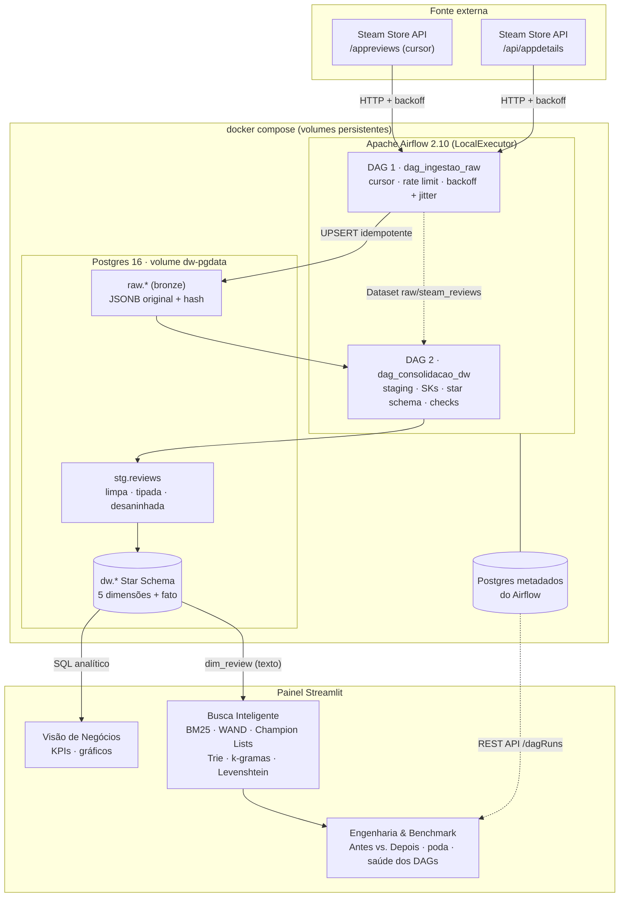
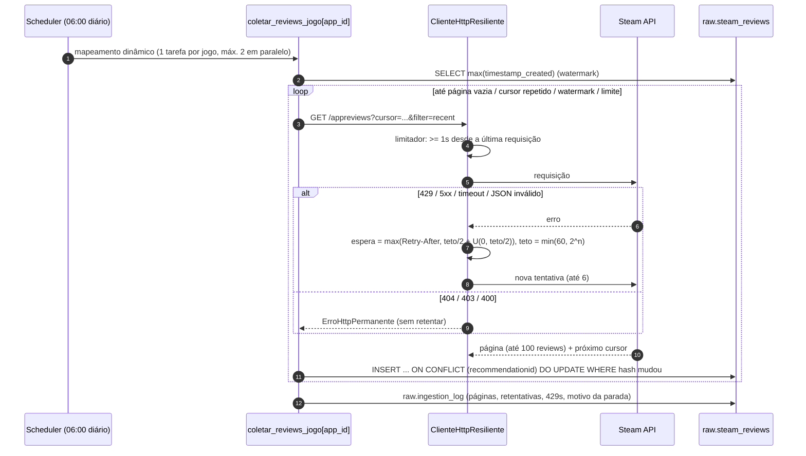
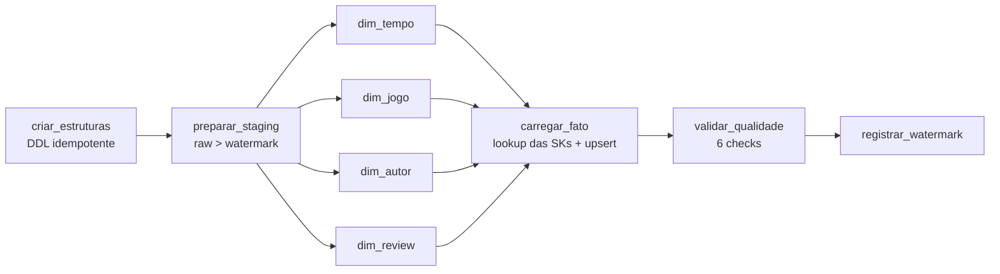

# Arquitetura e Decisões de Engenharia

## 1. Visão geral

## 2. Componentes e por que foram escolhidos

| Componente | Escolha | Motivo |
|---|---|---|
| Orquestração | Airflow 2.10.5, LocalExecutor | A spec pede Webserver + Scheduler + Triggerer + Postgres de metadados. O LocalExecutor roda tarefas em paralelo sem precisar de Redis ou Celery |
| Banco de metadados | `airflow-postgres` (volume `airflow-pgdata`) | Isolado do DW: limpar o Airflow não apaga dados |
| Bronze, staging e DW | `dw-postgres` com schemas `raw`, `stg` e `dw` (volume `dw-pgdata`) | JSONB preserva o payload original. Upsert por PK resolve a idempotência no próprio banco |
| Encadeamento | **Dataset** `postgres://dw-postgres:5432/dw/raw/steam_reviews` | Orientado a dados: o DAG 2 roda quando o DAG 1 **publica dados**, não num horário chutado |
| Painel | Streamlit + Altair | Python puro, conecta direto no Postgres, com tooltips interativos |
| Motor de busca | Python puro (sem bibliotecas de RI) | Todo algoritmo do benchmark é implementado e explicável linha a linha |

## 3. DAG 1: ingestão resiliente

### Estratégias de resiliência

| Problema | Tratamento | Onde |
|---|---|---|
| Paginação | Cursor opaco da Steam (`cursor=*` na primeira página, depois o `cursor` devolvido). Para em página vazia, cursor repetido (bug conhecido da API no fim da lista), página incompleta, watermark ou limite de páginas | `steam_api.py` |
| Rate limit (HTTP 429) | Retentativa com **exponential backoff com equal jitter**. Se vier `Retry-After`, a espera nunca é menor que ele | `http_client.py` |
| Instabilidade (500/502/503/504, timeout, conexão) | Mesmo backoff, até 6 retentativas, teto de 60 s por espera | `http_client.py` |
| Resposta 200 inválida (HTML de erro) | Tratada como retentável | `http_client.py` |
| Erro permanente (400/403/404) | Falha imediata, sem desperdiçar requisições | `http_client.py` |
| Polidez | Intervalo mínimo de 1 s entre requisições por cliente; no máximo 2 jogos em paralelo (`max_active_tis_per_dagrun=2`); User-Agent identificado | DAG 1 |
| Falha da tarefa inteira | `retries=3` do Airflow com `retry_exponential_backoff=True` (1 min → 15 min) | DAG 1 |
| Falha parcial (um jogo cai) | `publicar_dataset_raw` usa `trigger_rule=ALL_DONE`: publica o Dataset se ao menos um jogo foi coletado e registra o erro dos outros no `ingestion_log` | DAG 1 |

Por que *equal jitter*: sem jitter, vários clientes que levaram 429 ao mesmo tempo voltam juntos e levam 429 de novo (*thundering herd*). O *full jitter* espalha melhor, mas pode sortear espera ≈ 0. O *equal jitter* garante pelo menos metade do teto e ainda espalha as tentativas.

### Carga incremental

* Primeira execução de um jogo: até `max_paginas_inicial` páginas (25 × 100 = 2.500 reviews por jogo).
* Execuções seguintes: lê o **watermark** (`max(timestamp_created)` do jogo na raw) e para ao alcançar reviews mais antigas que `watermark − 2 dias`. A sobreposição de 2 dias captura edições recentes de votos e textos, e o upsert evita duplicatas.

## 4. Idempotência, demonstrada formalmente

| Camada | Mecanismo | Por que reexecutar não duplica |
|---|---|---|
| `raw.steam_reviews` | `PRIMARY KEY (recommendationid)` + `ON CONFLICT DO UPDATE ... WHERE payload_hash IS DISTINCT FROM EXCLUDED.payload_hash` | A mesma review sempre cai na mesma linha. Se o conteúdo é igual, nada é escrito e `last_ingested_at` não muda |
| `raw.ingestion_log` | `PRIMARY KEY (run_id, app_id, entidade)` + upsert | *Clear/Retry* da tarefa sobrescreve o registro da mesma execução |
| `stg.reviews` | `TRUNCATE` + `INSERT` a cada execução | Estado sempre derivado da raw |
| Dimensões | `UNIQUE` na chave natural + `ON CONFLICT DO UPDATE` (SCD1) ou `DO NOTHING` | A SK de uma entidade nunca muda; reexecutar não cria outra |
| `dw.fato_review` | `UNIQUE (recommendationid)` + `ON CONFLICT DO UPDATE WHERE métricas mudaram` | Grão = 1 review = 1 linha. Reprocessar não soma de novo, só atualiza votos que mudaram na fonte |
| Watermark do DAG 2 | `dw.etl_controle`, atualizado **só depois** dos checks de qualidade, com `GREATEST` | Se a carga falha no meio, a próxima execução reprocessa a mesma janela |

**Provas executáveis:**

1. `python -m scripts.verificar_idempotencia`: tira uma impressão digital do DW (contagens, somas das métricas e MD5 de todas as linhas da fato), reprocessa a raw inteira em *full refresh* e compara. Tem que dar idêntico.
2. `tests/test_integracao_dw.py`: roda no CI contra um Postgres real e cobre retry com o mesmo lote, incremental vazio, full refresh e review editada na fonte (1 update, 0 inserts).
3. Painel → Engenharia: o histórico de `dw.etl_execucao` mostra `total_fato` e `soma_votos_uteis` estáveis entre reexecuções.

## 5. DAG 2: consolidação

**Limpeza e transformação (staging):** desaninhamento do JSON (`author.steamid`, `author.playtime_at_review`, ...), tipagem (epoch → `timestamp` em America/Sao_Paulo, texto → boolean/int/numeric), remoção de BBCode (`[b]`, `[spoiler]`, `[url=...]`) e de URLs, normalização de espaços, deduplicação (`DISTINCT ON` pela versão mais recente) e tratamento do overflow de `votes_funny`.

**Checks de qualidade (falham o DAG se ≠ 0):** fato duplicada por review · fato apontando para membro desconhecido · review da raw ausente na fato · `qtd_reviews ≠ 1` · recomendação inconsistente · métricas negativas.

## 6. Persistência

| Volume | Conteúdo | Sobrevive a `docker compose down`? |
|---|---|---|
| `airflow-pgdata` | Metadados do Airflow (execuções, usuários) | Sim |
| `dw-pgdata` | raw + stg + DW | Sim |
| `airflow-logs` | Logs das tarefas | Sim |

Só `docker compose down -v` apaga os volumes.
