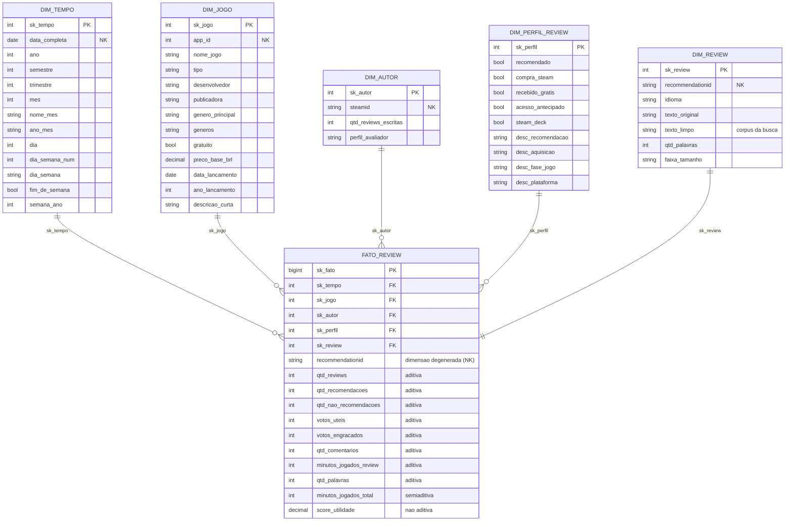

# Modelo Dimensional (Kimball) — Dicionário de Dados

## 1. Processo de negócio e granularidade

**Processo de negócio:** publicação de avaliações (*reviews*) de jogos na Steam por jogadores brasileiros.

> **Granularidade da fato `dw.fato_review`:** *cada linha representa UMA review publicada por um jogador sobre um jogo na Steam, na data em que a review foi criada.*

O grão é o mais atômico que a fonte oferece (uma review). Assim qualquer agregação, como por jogo, por mês, por perfil de jogador ou por origem da cópia, sai da mesma tabela sem dupla contagem. A chave natural da fonte (`recommendationid`) fica na fato como **dimensão degenerada**: ela não tem atributos próprios, mas é a chave que torna a carga idempotente (`UNIQUE` + `UPSERT`).

## 2. Diagrama Star Schema



## 3. Decisões de modelagem

| Decisão | Justificativa (Kimball) |
|---|---|
| **Surrogate keys inteiras** (`GENERATED BY DEFAULT AS IDENTITY`) em todas as dimensões | Desacoplam o DW das chaves da Steam (`app_id`, `steamid`, `recommendationid`). Se a fonte mudar ou reutilizar um identificador, o DW não quebra. Joins por inteiro também são mais baratos que por texto. |
| **Membro desconhecido `sk = -1`** em cada dimensão | A fato nunca recebe FK nula nem órfã. Se o lookup falhar, a linha aponta para "Desconhecido", e o check de qualidade `fato_sem_dimensao_conhecida` acusa o problema. |
| **`dim_perfil_review` como *junk dimension*** | Cinco flags de baixa cardinalidade (recomendado, compra na Steam, recebida grátis, acesso antecipado, Steam Deck) viram **uma** dimensão de 32 linhas pré-populadas, em vez de cinco FKs ou flags soltas na fato. |
| **`dim_review` separada da fato** | Texto longo não pertence à fato, que deve ser estreita e numérica. A dimensão de texto tem a mesma cardinalidade da fato (relação 1:1), é o corpus indexado pelo motor de busca e mantém a fato enxuta para agregações. |
| **`dim_tempo` gerada por calendário** | Todos os dias dos meses cobertos são criados, inclusive dias sem reviews, o que permite séries temporais contínuas. Atributos em português (`nome_mes`, `dia_semana`). |
| **SCD tipo 1** em `dim_jogo` e `dim_autor` | Para a análise interessa o estado atual (preço, gênero, reviews escritas). Mudanças sobrescrevem o atributo e a SK se mantém. |
| **Integridade referencial** | `FOREIGN KEY` real da fato para cada dimensão, mais os checks de qualidade do DAG 2. |

## 4. Dicionário da fato `dw.fato_review`

| Coluna | Tipo | Aditividade | Descrição |
|---|---|---|---|
| `sk_fato` | bigint | — | Chave substituta da linha da fato |
| `sk_tempo`, `sk_jogo`, `sk_autor`, `sk_perfil`, `sk_review` | int | — | FKs para as surrogate keys das dimensões |
| `recommendationid` | text | — | Dimensão degenerada (ID da review na Steam); chave do upsert idempotente |
| `qtd_reviews` | int | **Aditiva** | Sempre 1. Soma = número de reviews em qualquer corte |
| `qtd_recomendacoes` | int | **Aditiva** | 1 se o jogador recomendou. `sum(qtd_recomendacoes)/sum(qtd_reviews)` = taxa de recomendação |
| `qtd_nao_recomendacoes` | int | **Aditiva** | 1 se não recomendou |
| `votos_uteis` | int | **Aditiva** | Votos "esta review foi útil" |
| `votos_engracados` | int | **Aditiva** | Votos "engraçada" (o overflow `4294967295` da API vira 0) |
| `qtd_comentarios` | int | **Aditiva** | Comentários na review |
| `minutos_jogados_review` | int | **Aditiva** | Tempo de jogo do autor **no momento** em que escreveu a review |
| `qtd_palavras` | int | **Aditiva** | Palavras do texto limpo |
| `minutos_jogados_total` | int | **Semiaditiva** | Foto do tempo total de jogo **na data da coleta**. Soma entre jogadores, mas não deve ser somada ao longo de coletas diferentes. Use média ou o valor mais recente |
| `score_utilidade` | numeric | **Não aditiva** | `weighted_vote_score` da Steam (0 a 1). Use média, nunca soma |

## 5. Dicionário das dimensões

| Dimensão | NK | Atributos principais | Uso analítico |
|---|---|---|---|
| `dim_tempo` | `data_completa` | ano, semestre, trimestre, mês, nome do mês, `ano_mes`, dia, dia da semana, fim de semana, semana do ano | Tendência mensal, sazonalidade, dia da semana |
| `dim_jogo` | `app_id` | nome, desenvolvedora, publicadora, gênero principal, gêneros, gratuito, preço base (BRL), data e ano de lançamento, descrição | Ranking de recomendação por jogo e gênero |
| `dim_autor` | `steamid` | reviews escritas, perfil de avaliador (primeira review, ocasional, frequente, veterano) | Segmentação de avaliadores casuais e veteranos |
| `dim_perfil_review` | 5 flags | recomendado, origem da cópia, fase do jogo, plataforma (com descrições legíveis) | Filtros e `GROUP BY` sem joins extras |
| `dim_review` | `recommendationid` | idioma, texto original, texto limpo (sem BBCode e URLs), palavras, faixa de tamanho | Corpus do motor de busca BM25/WAND |

## 6. Exemplos de consultas analíticas

```sql
-- Taxa de recomendação e horas medianas por jogo
SELECT j.nome_jogo,
       sum(f.qtd_reviews)                                    AS reviews,
       round(100.0 * sum(f.qtd_recomendacoes) / sum(f.qtd_reviews), 1) AS pct_recomendam,
       percentile_cont(0.5) WITHIN GROUP (ORDER BY f.minutos_jogados_review) / 60 AS horas_mediana
FROM dw.fato_review f JOIN dw.dim_jogo j USING (sk_jogo)
GROUP BY 1 ORDER BY 3 DESC;

-- Evolução mensal: recomendado x não recomendado
SELECT t.ano_mes, p.desc_recomendacao, sum(f.qtd_reviews)
FROM dw.fato_review f
JOIN dw.dim_tempo t USING (sk_tempo)
JOIN dw.dim_perfil_review p USING (sk_perfil)
GROUP BY 1, 2 ORDER BY 1;

-- Jogadores veteranos são mais críticos?
SELECT a.perfil_avaliador, round(100.0 * sum(f.qtd_recomendacoes) / sum(f.qtd_reviews), 1)
FROM dw.fato_review f JOIN dw.dim_autor a USING (sk_autor)
GROUP BY 1 ORDER BY 1;
```
